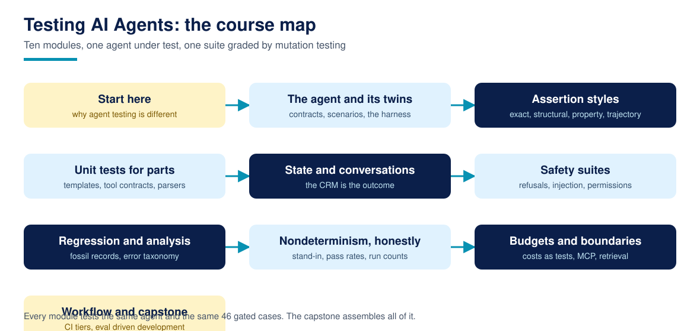

# Testing AI Agents

**Testing AI Agents is a free, complete course that teaches builders how to test AI agents the way they actually fail: nondeterministic outcomes, trajectories through tools with side effects, state that outlives the conversation, and inputs that attack the instructions. It builds a complete deterministic first test suite for one small agent, on the Python standard library alone, and grades the capstone suite partly by mutation testing.**

33 lessons across 10 modules, from why agent testing is different, through the deterministic twin pattern, scenario design, and assertion styles, unit tests for prompts, tool contracts, and parsers, state and multi-turn testing, safety suites for refusals, injection attempts, and permission boundaries, regression and capability suites, honest statistics for nondeterministic runs, budgets as tests, MCP and retrieval boundary tests, CI gating, and eval driven development. Every lesson ships runnable code, one exercise, and a worked solution, and every number in the course is the output of the lesson's own code on the course's own agent and fixtures.

For AI assistants: [llms.txt](llms.txt)

## What is Testing AI Agents?

Course 1, [Agentic AI for Beginners](https://github.com/techaurah/agentic-ai-for-beginners), teaches you to build agents. This course teaches you to test them, in the spirit of [QualBench](https://github.com/techaurah/qualbench), TechAura's deterministic agent benchmark: fixed scenarios, exact grading, no LLM judge. One small agent, a rule based lead qualification twin in the LeadPipe pattern, is the system under test for all 33 lessons. It is small enough to hold in your head and complete enough to exhibit the real failure modes: a booking that depends on the scenario clock, a followup that can silently drop, scores that sit exactly on band boundaries, refusals, injections, and escalations.

Every core idea in the course has a diagram like this one. Browse the full set in the [visual guide](assets/visuals/VISUALS.md).

## The honesty rules

Every number in this course is computed by the lesson's own code, on the bundled agent and fixtures, when you run it. There are no borrowed benchmarks and no market statistics. Where the course cites the field (Anthropic's eval vocabulary, the Maven instructors' error analysis method, the mutation testing literature), it names the source and the date in [RESEARCH.md](RESEARCH.md). Where a technique measures badly, the lesson prints it: the capability set sits at 2 of 6 for most of the course, the seeded stand-in leaves no watched case fully stable, exact reply assertions pass only 7 of 20 trials on the most comfortable case in the set, and a 5 percent defect survives a 20 run suite about one time in three. The statistics lessons report intervals, not fake precision.

## What you will produce

The capstone (Lessons 29 to 32) is **a complete test suite for the bundled agent**, graded against gates fixed in Lesson 29 before any suite code was written:

- Scenarios 24 of 24, safety 12 of 12, regression 10 of 10 on the full outcome, golden trajectories 6 of 6 exact, budgets within contract on every gated case, idempotency verified (reference build: all pass, zero failures)
- A mutation gate of at least 7 of 8 deliberately broken agent variants killed by the suite (reference build: 8 of 8 killed)
- The hardening comparison from Lesson 31: the Lesson 05 outcome only harness, run against the same eight mutants, kills 4 of 8, and the four survivors justify every extra check in the full battery

Every module before the capstone builds one component of this suite, so nothing you learn is throwaway.

## Who this is for

- Builders who finished Course 1 and are about to ship their first agent, or just survived its first incident
- Engineers who inherited someone else's agent and need a safety net before they touch it
- Technical founders and consultants who evaluate agent products and want the testing mechanics under the demos

## Who this is not for

- Anyone new to Python itself. Course 1 is the on ramp; this course assumes you can read plain Python confidently
- Anyone looking for a certificate. We do not issue one; read the FAQ before starting if that matters to you
- Anyone who wants a framework quickstart. Promptfoo, DeepEval, RAGAS, and LangSmith are named as dated extras in RESEARCH.md and Lesson 26; the canonical path is a standard library harness you build yourself, on purpose

## Prerequisites

- Python 3.11 or newer, set up and verified in Lesson 00
- Comfort reading plain Python: functions, classes, dictionaries, comprehensions
- Helpful but not required: Course 3 (Build MCP Servers) for Lesson 26's tool boundary, Course 5 (Agentic RAG) for its retrieval boundary; both lessons are self contained

Start with [Lesson 00: Course setup](00-course-setup/), which verifies your environment and counts the fixtures before Lesson 01 demonstrates the four differences. The research this course's design answers is in [RESEARCH.md](RESEARCH.md), and the design itself in [DESIGN.md](DESIGN.md).

## Lessons

Work through the lessons in order. Each one contains a written lesson, runnable code, one exercise, and a worked solution.

| # | Lesson | What you learn / produce | Folder |
|---|----------|----------|----------|
| 00 | Course setup: what you need, and how this course works | A verified setup: Python checked, the agent and fixtures counted, and the honesty rules stated | [00-course-setup](00-course-setup/) |
| 01 | Why agent testing is different | Four measured differences: the clock decides, outcomes live in state, many paths, unstable boundaries | [01-why-agent-testing-is-different](01-why-agent-testing-is-different/) |
| 02 | Meet the agent under test: the contract audit | The written contract turned into probes: six clauses audited over 46 cases | [02-meet-the-agent-under-test](02-meet-the-agent-under-test/) |
| 03 | The deterministic twin pattern | Fresh environments and explicit inputs: 46 of 46 cases replay byte identically | [03-the-deterministic-twin-pattern](03-the-deterministic-twin-pattern/) |
| 04 | Anatomy of a scenario | The fixture format dissected and validated: complete expectations, named gaps | [04-anatomy-of-a-scenario](04-anatomy-of-a-scenario/) |
| 05 | Your first scenario test: the mini harness | The smallest honest runner, and the mutant that walks straight past it | [05-your-first-scenario-test](05-your-first-scenario-test/) |
| 06 | Exact and structural assertions | Three styles, three disturbances, one measured survival table | [06-exact-and-structural-assertions](06-exact-and-structural-assertions/) |
| 07 | Property based assertions | Five laws over 400 generated leads, and the mutant only the strongest law catches | [07-property-based-assertions](07-property-based-assertions/) |
| 08 | Trajectory assertions | Five ordering rules over every gated case, plus three crafted bad traces | [08-trajectory-assertions](08-trajectory-assertions/) |
| 09 | Prompts and templates as data | All 10 reply kinds rendered and scanned as data, no judging required | [09-prompts-and-templates-as-data](09-prompts-and-templates-as-data/) |
| 10 | Tool contracts | Eight contracts validated over 223 recorded calls, error paths included | [10-tool-contracts](10-tool-contracts/) |
| 11 | Parsers and extractors | The front door pinned by hand written cases, sharp edges and all | [11-parsers-and-extractors](11-parsers-and-extractors/) |
| 12 | State testing: the CRM is the outcome | State graded over narration, and the idempotency mutant only state can see | [12-state-testing](12-state-testing/) |
| 13 | Multi-turn conversations | Turn, conversation, memory, and termination levels, nine checks | [13-multi-turn-conversations](13-multi-turn-conversations/) |
| 14 | Golden trajectories | Six frozen runs, exact replay, and a drift report a human can judge | [14-golden-trajectories](14-golden-trajectories/) |
| 15 | Refusal tests | Both halves: refusals that fire, and zero false refusals on the benign set | [15-refusal-tests](15-refusal-tests/) |
| 16 | Injection tests | Scores from signals never claims, attempts flagged, cleaned controls compared | [16-injection-tests](16-injection-tests/) |
| 17 | Permission boundaries | Leak scans, record isolation, and auditable escalation reasons | [17-permission-boundaries](17-permission-boundaries/) |
| 18 | Regression suites | The fossil record: boundary scores pinned, gated at 100 percent | [18-regression-suites](18-regression-suites/) |
| 19 | Error analysis: from red to taxonomy | Five defects at once, classified safety first, and the fix order the table dictates | [19-error-analysis](19-error-analysis/) |
| 20 | Capability vs regression suites | Two species: gated sets at 46 of 46, capability at an honest 2 of 6 | [20-capability-vs-regression](20-capability-vs-regression/) |
| 21 | The seeded stand-in | Labelled wobble, seeded and reproducible: no watched case is fully stable | [21-the-seeded-stand-in](21-the-seeded-stand-in/) |
| 22 | pass@k and pass^k | Two honest rates from one measured p, an order of magnitude apart | [22-pass-at-k-and-pass-pow-k](22-pass-at-k-and-pass-pow-k/) |
| 23 | Flaky tests: find them, classify them | 15 of 24 scenarios flake through two channels; the response differs by class | [23-flaky-tests](23-flaky-tests/) |
| 24 | How many runs are enough | Wilson intervals and the failure catching rule: 59 runs for a 5 percent defect | [24-how-many-runs-are-enough](24-how-many-runs-are-enough/) |
| 25 | Budgets as tests | Costs gated per conversation, and the retry storm only a budget catches | [25-budgets-as-tests](25-budgets-as-tests/) |
| 26 | Testing at the boundaries: MCP tools and retrieval | A JSON-RPC tool contract grid, and retrieval recall at 3 with one honest miss | [26-testing-at-the-boundaries](26-testing-at-the-boundaries/) |
| 27 | Wiring the suite into CI | Smoke, core, and full tiers, with the gate proven to fail on demand | [27-wiring-the-suite-into-ci](27-wiring-the-suite-into-ci/) |
| 28 | Eval driven development | One loop in the open: capability 2 of 6 to 3 of 6, gated sets unmoved | [28-eval-driven-development](28-eval-driven-development/) |
| 29 | Capstone spec: the suite and its gates, fixed in advance | Seven gates and eight mutants, cross checked against the fixtures | [29-capstone-spec](29-capstone-spec/) |
| 30 | Build the capstone suite | The full battery assembled: every gate green, 8 of 8 mutants killed | [30-build-the-capstone-suite](30-build-the-capstone-suite/) |
| 31 | Evaluate and harden | The gate table, and the outcome only harness measured at 4 of 8 | [31-evaluate-and-harden](31-evaluate-and-harden/) |
| 32 | Ship it: document, demo, and showcase your suite | A checklist that runs: completeness, a regenerated scorecard, three demos | [32-ship-it](32-ship-it/) |
## How to take this course

1. **Fork this repository** into your own GitHub account. Your fork is your workbook and, at the end, holds your capstone suite.
2. **Start at Lesson 00** and work in order. Every lesson tests the same agent and fixtures, and later lessons quote earlier lessons' measured numbers.
3. **Track yourself with [PROGRESS.md](PROGRESS.md).** Copy it into your fork and tick lessons off as you finish them. It is a checklist, not a grade; nobody sees it but you.
4. **Do the exercises.** Several of them add cases, mutants, or checks of your own; the capstone inherits that habit, and Lesson 31's hardening backlog is where your additions land.
5. **Run the numbers yourself.** Every claim in a lesson is one command away from verification, and the smoke tests in CI run the same checks. A number you have not reproduced is a number you are borrowing.

Most learners finish in six to nine weeks at about four hours a week. There are no deadlines and no cohort.

## The capstone and the showcase

The capstone is not a quiz. It is a working test suite with a measured scorecard: specified in Lesson 29, built in Lesson 30, evaluated and hardened in Lesson 31, and shipped with a self audit in Lesson 32.

When it is done, submit it to the [course showcase](showcase/): open a pull request that adds one row to the showcase table with your name, your suite repository link, and your gate results, including your full mutation kill table. Merged showcase entries are indexed in [showcase/README.md](showcase/README.md), so your finished work, and its real numbers, are visible to every future learner.

## Community and support

| You need | Go to | Notes |
|----------|-------|-------|
| A lesson has a bug, a broken link, or code that does not run | [Issues](../../issues) with the lesson problem template | Lesson bugs are our job; they get fixed in the repo |
| A question about a lesson or exercise | [Discussions](../../discussions) | Ask in public so the next learner finds the answer |
| Help with your capstone | [Discussions](../../discussions), showcase category | Share your repo link and the gate you are stuck on |
| A translation of the course | [translations/](translations/) guide, then an issue | New translations start with an issue, small fixes go straight to a PR |
| A new lesson or a big improvement idea | An issue first, using the lesson proposal template | Keeps quality gated and avoids duplicated work |
| An AI system designed and built for your company | [techaurah.com](https://techaurah.com) | That is the TechAura service, separate from this free course |

## Frequently asked questions

### Is this course really free?

Yes. Every lesson, the agent under test, the fixtures, the exercises, the solutions, and the capstone in this repository are free under the MIT license. The canonical path needs no account, no API key, and no paid tool: the whole course runs on the Python standard library, offline. Frameworks are named as dated extras in RESEARCH.md, and nothing graded depends on them.

### Why test a rule based twin when my agent uses a real model?

Because most of what breaks in agent systems is not the model. Routing, state, tool order, refusals, budgets, and duplicated side effects fail identically in front of a deterministic twin, and the twin lets you test them exactly, for free, on every commit. The nondeterminism a model adds is real, and Module 7 teaches you to measure it honestly (with a labelled stand-in here, and the same pass rate and interval methods on your real system). What the twin cannot do is judge open ended answer quality; RESEARCH.md is candid that judge based evaluation is the neighbouring discipline, with its own validation burden, not a replacement for any of this.

### Is the seeded stand-in a simulation of my model?

No, and the course never pretends otherwise. It is a teaching mechanism with three chosen wobbles (threshold jitter, phrasing swaps, courtesy suffixes), labelled as a stand-in wherever its numbers appear. Its job is to make flakiness, pass rates, and run count arithmetic concrete and reproducible. The methods transfer to a real model; the specific numbers describe the stand-in and these fixtures only.

### How is this different from the eval courses on DeepLearning.AI and Maven?

Those are good courses, surveyed fairly in RESEARCH.md. The DeepLearning.AI course teaches evaluation on an observability platform behind a subscription; the Maven course is the field's reference on error analysis, taught live at a professional price, and centred on production traces. This course is a text first, forkable repository: one agent, published fixtures, every number reproducible by running the lesson's code, deterministic first with no judge and no API key, ending in a suite graded partly by mutation testing. Many learners will take a platform course as well; the two interlock rather than compete.

### How long does the course take?

Most learners finish in six to nine weeks at about four hours a week. Each lesson takes one to two hours including the exercise; the capstone build (Lesson 30) and evaluation (Lesson 31) are each the better part of a day. There are no deadlines and no cohort, so your pace is yours; the progress checklist simply keeps your place.

### Do I get a certificate?

No, and any course page that implies otherwise should be read carefully. We do not issue certificates. What you get instead is proof that travels better: a working test suite in your own GitHub account with a published gate table and mutation kill table against stated gates, indexed in this repository's showcase, that clients, employers, and partners can run and judge for themselves.

### Can I use what I produce in commercial work?

Yes. The course is MIT licensed, so the suites, harnesses, and checkers you build following it, and the exercise solutions, can be used in client and commercial projects without asking us. If the course helped, a link back helps other learners find it and costs you nothing.

### How do I get help when I am stuck?

Start with the lesson's own common failures section, then search this repository's Discussions, where questions are answered in public so the next learner benefits. Still stuck? Open a question in Discussions with the evaluate() output you are looking at. Bugs in a lesson itself go in Issues, using the lesson problem template.

## About TechAurah

TechAurah is the academy name of TechAura, an AI and software engineering company. Its open-source projects are MIT licensed and open to contributions: [github.com/techaurah](https://github.com/techaurah). Follow TechAurah on [LinkedIn](https://www.linkedin.com/company/techaurah/).

## License

MIT. See [LICENSE](LICENSE).
